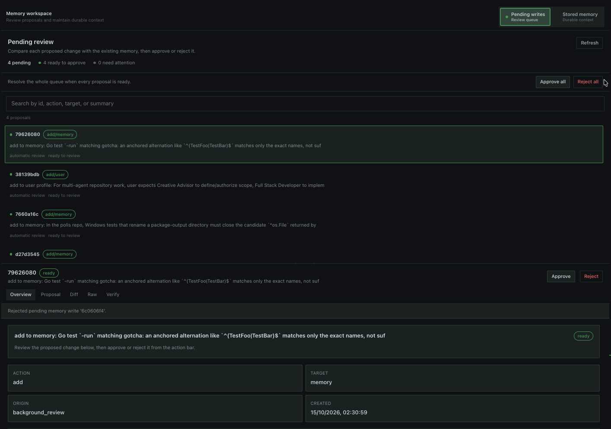
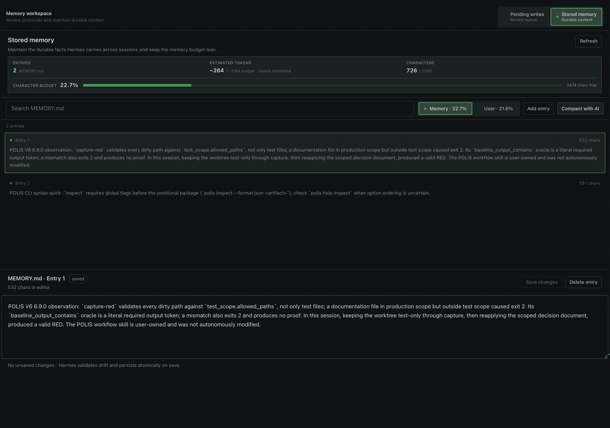

# Magi

Magi is a Hermes plugin for reviewing pending memory writes and managing the built-in `MEMORY.md` and `USER.md` stores in Hermes Desktop. Requires Hermes `>=0.21.5`.

**Current version:** 1.7.8


## Install

```bash
hermes plugins install https://github.com/MarcosAlves90/magi
hermes plugins enable magi
```

In Hermes Desktop, go to **Capabilities → Plugins** and enable both the **Agent** plugin for your active profile and the **Desktop Magi** plugin. These switches are independent. If Desktop was already open, choose **Rescan** first. Then open **Magi** from the sidebar.

## Use Magi in Desktop

### Pending writes



### Stored memory



- **Pending writes:** Review each proposal using **Overview**, **Proposal**, **Diff**, **Raw**, or **Verify**, then approve or reject it. Combine text search with action (`add`, `replace`, `remove`, `batch`), target store, origin, target status, and inclusive UTC creation-date filters; **Clear filters** restores the full queue. Invalid or missing dates display as **Unknown date** and do not match date ranges. The filtered count is shown alongside the total. **Approve all** and **Reject all** always act on the **entire queue**, including hidden matches, and require confirmation. Proposals targeting entries that no longer exist are marked obsolete and can be removed with **Delete obsolete**.
- **Stored memory:** Switch between **Memory** (`MEMORY.md`) and **User** (`USER.md`). Search entries, inspect usage and remaining capacity, and add or edit entries. Deletion requires confirmation. Expand **Memory diagnostics** for each store to inspect exact entry counts, characters used/free, entry-size ranges, entries longer than 500 characters, and groups of exactly identical text. Use **View entry** to inspect a flagged entry. These are local, deterministic, informational indicators: long text is not necessarily poor quality, identical text does not detect semantic redundancy or contradictions, and diagnostics never edit data or call AI.
- **Resizable views:** Drag the lower edge of the pending-write inspector or stored-memory editor to change its height.
- **AI compaction:** Select a store and choose **Compact with AI** to review a proposed shorter version. Magi accepts a preview only if it uses at most 60% of the original characters (at least a 40% reduction); it can retry up to three times. If no safe reduction is available, the memory stays unchanged. Nothing is written until you choose **Apply compaction**. Magi rejects a stale source at its initial fingerprint check and Hermes rejects missing or changed pinned entries under its batch lock. Concurrent additions may still be preserved; this is not a full-snapshot check under the lock.

Pending-write decisions and compaction previews work without an open chat session. Stored-memory changes use Hermes' native memory safeguards, including checks against stale data.

Decision responses report `outcome: complete | partial | failed`, counts (`attempted`, `applied`, `rejected`, `failed`) and per-record `items[]` with status and errors. A partial batch can return HTTP 200 because the request completed at the transport layer; `success` is true only when every selected decision and its pending-file cleanup completed. If a memory write was applied but the proposal file could not be removed, its status is `applied_cleanup_failed`: inspect and reconcile it before considering any retry. The legacy `output` text is retained.

Before approval, Magi validates each pending proposal's structure and checks destructive `matched_entry` pins against the currently readable target. Malformed, missing and unverifiable proposals cannot be approved, but may be rejected. **Approve all** attempts individually eligible records and reports blocked records in the partial result. Checks in Magi are preconditions before the native Hermes operation, not an atomic snapshot guarantee; concurrent changes can still cause a native rejection.

## Configuration

Set these options in the Magi plugin settings:

| Option | Default | Purpose |
| --- | --- | --- |
| `compaction_model` | Empty | Model for AI compaction; empty uses the active/default Hermes model. |
| `home_override` | Empty | Optional custom Hermes home directory; empty uses the active profile. |
| `default_page_size` | `20` | Default number of pending writes listed. |
| `max_page_size` | `100` | Maximum number of list/search results. |

Choosing a specific `compaction_model` requires Hermes permission `plugins.entries.magi.llm.allow_model_override` and compliance with any configured `allowed_models` restriction.

## Commands

In a Hermes session:

```text
/magi list [page] [limit]
/magi show <id|prefix|oldest|newest>
/magi diff <id|prefix|oldest|newest>
/magi raw <id|prefix|oldest|newest>
/magi find <text>
/magi stats
/magi verify [id|all]
/magi path <id|prefix>
/memory-show <id|prefix>
/memory-compact-preview <memory|user>
```

From the terminal:

```bash
hermes magi list
hermes magi show newest
hermes magi diff <id> | less
hermes magi raw <id> | less
hermes magi verify all
```

Use the terminal for large records that may exceed chat message limits.

## Security and privacy

- **Local reads:** Magi reads the active profile's pending-memory records and Hermes' `MEMORY.md` / `USER.md` stores. `home_override` can redirect these reads to a home directory you select.
- **Changes:** Approval, rejection, entry edits and compaction require explicit user actions. Writes go through Hermes' native memory APIs; Magi does not edit the stores directly.
- **AI access:** Compaction sends the selected memory content through Hermes' `ctx.llm` interface to the configured model/provider. Hermes owns provider credentials; Magi does not read or store them.
- **Other activity:** Magi makes no direct third-party network calls, launches no shell commands or subprocesses, runs no long-lived background jobs, and collects no telemetry or usage data. While its Desktop page is open, it polls the local plugin backend every five seconds.

## Development

Run the repository verification suite:

```bash
./verify.sh
```

This checks Python syntax, runs tests, enforces the **production line-coverage gate >90%**, and validates the plugin with Hermes' `plugins validate --install-deps` admission check. Run `bash ci/coverage.sh` independently to regenerate `coverage.xml` and print missing lines and branches for `__init__.py`, `core.py`, `runtime_bridge.py`, and `dashboard/plugin_api.py`. Tests under `tests/` are excluded from the production denominator. The report uses branch instrumentation, but the gate measures **lines**, not branches. On baseline `d9c72a8`, the old global XML report (including tests) measured **96.45%** line coverage; the production-only subset measured **774/846 = 91.49%** lines, a materially different metric. This figure describes exercised code, not the completeness of behavior testing or software security. Compaction apply calls Hermes' public `MemoryStore.apply_batch` and does not rebind its private `_mutate` method. See [Hermes memory compatibility and upstream dependencies](docs/hermes-memory-compatibility.md) for concurrency limits, pre-existing serialization behavior, and test evidence.

`verify.sh` invokes pytest **once**, inside `ci/coverage.sh`, and still propagates test and coverage failures. `bash ci/test.sh` remains available for test-only runs. On this macOS workspace, end-to-end `verify.sh` wall-clock time measured **38.66s** on `d9c72a8` (two test passes), **36.73s** after MAGI-013 (two passes), and **17.35s** after MAGI-020 (one pass). The observed final reduction against the original baseline is **21.31s (55.1%)**; individual runs are subject to machine load and warmed dependencies, so this is a measured comparison rather than a guaranteed speedup.
