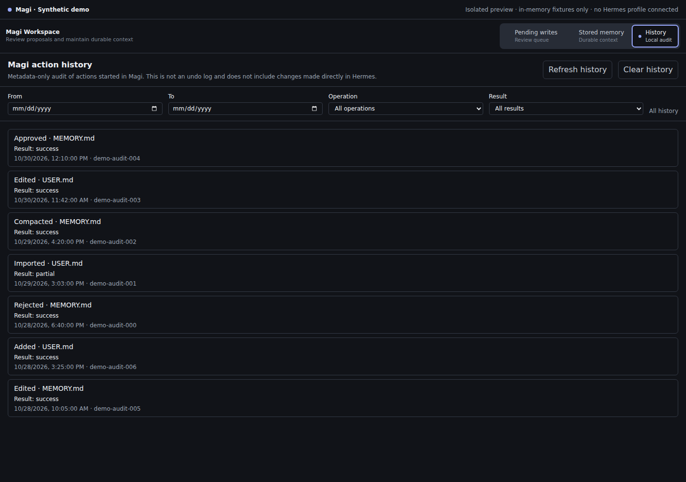

# Magi

**Intentional, human-reviewed memory management for Hermes.**


**Current version:** 1.8.3 · **Requires Hermes:** `>=0.21.5`

Magi brings pending memory proposals and Hermes' durable `MEMORY.md` / `USER.md` stores into one Desktop workspace. Review changes before they become durable, maintain the context you want Hermes to carry forward, and keep optional AI assistance behind a preview and explicit confirmation.

## Magi at a glance

| Review proposals | Maintain durable context | Keep control |
| --- | --- | --- |
| Inspect a pending change, compare its diff, then approve or reject it. | Search, add, edit, and inspect the character budget of Memory and User stores. | AI review and compaction are optional; proposals are inspected before anything is applied. |

### Pending writes


### Stored memory


### History



## How it works


Pending decisions and memory edits use Hermes' native safeguards. AI actions send selected memory through the model/provider configured in Hermes; they do not write automatically.

## Get started

```bash
hermes plugins install \
  https://github.com/MarcosAlves90/magi
hermes plugins enable magi
```

In Hermes Desktop, enable both **Agent** for your active profile and **Desktop Magi** under **Capabilities → Plugins**. If Desktop was already open, choose **Rescan**, then open **Magi** from the sidebar.

## Documentation

| I want to… | Read |
| --- | --- |
| Find the right guide | [Documentation index](docs/index.md) |
| Use the Desktop workspace and commands | [Usage guide](docs/using-magi.md) |
| Understand data handling and safeguards | [Security & privacy](docs/security-and-privacy.md) |
| Run tests or contribute | [Development guide](docs/development.md) |
| Check Hermes versions and CI coverage | [Hermes compatibility matrix](docs/hermes-compatibility-matrix.md) |
| Understand memory-store guarantees and limits | [Hermes memory compatibility](docs/hermes-memory-compatibility.md) |
| See version history | [Changelog](CHANGELOG.md) |

## Trust at a glance

- **You decide:** pending-write approvals, edits, imports, and AI compaction apply only after an explicit action.
- **Hermes persists:** Magi uses Hermes' native memory APIs; it does not edit the stores directly.
- **Local by design:** Magi makes no direct third-party network calls, launches no shell commands, and collects no telemetry. AI features use Hermes' configured provider.

See [Security & privacy](docs/security-and-privacy.md) for the data flow, model-consent requirements, and important concurrency and recovery limits.
