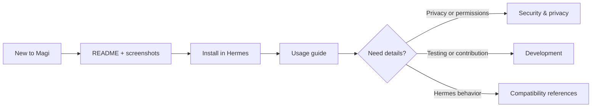

# Magi documentation

Choose the guide for what you need. The README is the short product introduction; this page is the map to detailed references.

| Topic | Guide | Contents |
| --- | --- | --- |
| Product overview | [README](../README.md) | What Magi does, Desktop screenshots, quick install |
| Day-to-day use | [Usage guide](using-magi.md) | Pending reviews, stored memory, AI previews, commands, settings |
| Data & trust | [Security and privacy](security-and-privacy.md) | Local data, AI transmission, permissions, IPC boundary, failure limits |
| Development | [Development guide](development.md) | Verification, coverage, Desktop tests, compatibility checks |
| Hermes versions | [Compatibility matrix](hermes-compatibility-matrix.md) | Pinned upstream revisions and repeatable CI evidence |
| Memory-store behavior | [Memory compatibility](hermes-memory-compatibility.md) | Native batch guarantees, known limits, and recovery evidence |
| Release history | [Changelog](../CHANGELOG.md) | User-visible changes by version |

## Choose a path

[Back to Magi](../README.md)
