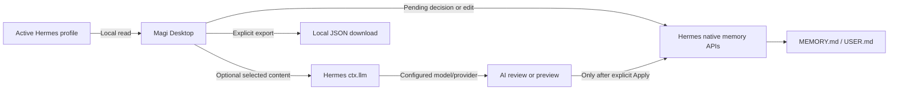

# Security and privacy

Magi operates inside the active Hermes profile. It keeps memory operations local unless you explicitly request an AI action through Hermes or export data yourself.

## Data flow

| Data/action | Where it goes | Control |
| --- | --- | --- |
| Pending proposals and stored `MEMORY.md` / `USER.md` | Read from the active profile (or the `home_override` you set) | Magi reads locally; mutations require an explicit action and use Hermes' native APIs. |
| AI review or compaction | Selected memory content is sent via Hermes' `ctx.llm` to the configured model/provider | Never automatic. AI proposals do not write; inspect and explicitly apply. |
| Preservation check | Original and proposed content are sent to the configured second model/provider | Experimental, idle until selected and separately confirmed. |
| Memory export | Browser-created JSON data URL / local download | May contain private information; Magi does not upload it. |
| Magi History | Bounded local metadata under the active profile | No memory text, prompts, tokens, or raw exceptions; not an undo log. |

## Permissions and model routing

Magi does not read or store provider credentials; Hermes owns credentials, provider selection, and LLM permission checks. Selecting `compaction_model` requires consent to the `llm.model_override` capability, Hermes' legacy LLM override trust permission where applicable, and any configured `allowed_models` restriction. If a host cannot probe capabilities, explicit overrides fail closed while the active/default model remains available.

Pending-write approval, rejection, stored-memory edits, import, export, and compaction apply are user-initiated. Magi does not edit `MEMORY.md` or `USER.md` directly. It makes no direct third-party network calls, launches no shell commands or subprocesses, and collects no telemetry or usage data. While its Desktop page is open, it polls the local plugin backend every five seconds.

## Local IPC boundary

The Agent plugin exposes a private Unix-domain socket under the active profile's `plugin-data/magi` directory so the Dashboard API can reach the active Agent's `ctx.llm` across processes. A permission-restricted `.magi-llm-ipc.lock` in the profile root coordinates startup and unload and contains no request data. The socket is restricted to the owning OS user and active profile path; processes running as that same OS user are inside the trust boundary. Hermes profiles are **not** OS-level isolation boundaries.

On unload—or startup failure after the serving thread begins—the listener stops accepting requests and waits for in-flight structured requests to finish before releasing `ctx.llm`. This drain has no fixed deadline: a provider call that never returns can keep unload or cleanup waiting indefinitely. Magi does not log prompts or read credentials. Restart the Agent plugin after upgrading from an older server; protocol-v1 listeners are rejected rather than reused.

## Guarantees and limits

- Hermes performs native validation and persistence. Magi's prechecks are not an atomic snapshot across the preview and write; concurrent changes can still cause rejection or, for concurrent additions, remain alongside a successful compaction.
- A successful batch is not an exactly-once guarantee across Hermes' memory store and Magi's pending queue. If the memory mutation succeeds but pending-file cleanup fails, Magi marks the proposal `applied_cleanup_failed` and requires inspection rather than automatic retry.
- Magi can record a content-free recovery marker after such a failure, but a crash can occur before the marker is written. External writers may also make a pending proposal ambiguous. See the [usage guide](using-magi.md#decision-results-and-recovery) and [memory compatibility analysis](hermes-memory-compatibility.md) for details.
- Local storage and IPC protect against other OS users; same-user local processes remain within the trust boundary. Do not treat the Hermes profile as a security sandbox.
