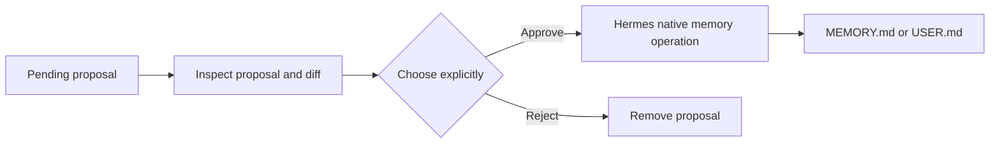

# Using Magi

Magi's Desktop workspace has two areas: **Pending writes** for proposed changes and **Stored memory** for the active profile's `MEMORY.md` and `USER.md`. Decisions and mutations require explicit actions; see [Security & privacy](security-and-privacy.md) for data flow and trust boundaries.

## Review pending writes

Use **Overview**, **Proposal**, **Diff**, **Raw**, or **Verify** to inspect a proposal before approving or rejecting it. Search is always available. **Filters** combine action (`add`, `replace`, `remove`, `batch`), target store, origin, status, and inclusive UTC creation-date ranges. Invalid or missing dates appear as **Unknown date** and do not match a date range. Active filters are counted; **Clear filters** restores the full queue. The filtered count appears alongside the total.

**Approve all** and **Reject all** apply to the entire queue, including items hidden by filters, and require confirmation. Proposals whose targets no longer exist are marked obsolete and can be removed with **Delete obsolete**.

Before approval, Magi checks proposal structure and destructive `matched_entry` pins against the currently readable target. Malformed, missing, or unverifiable proposals cannot be approved, but can be rejected. A memory-store read error disables approval. These are preconditions before Hermes' native operation, not an atomic snapshot guarantee; concurrent changes may still cause Hermes to reject a write.

Pending-write decisions and compaction previews work without an open chat session. Stored-memory changes still use Hermes' native safeguards, including stale-data checks.



### Decision results and recovery

Each decision response reports `outcome: complete | partial | failed`, counts (`attempted`, `applied`, `rejected`, `failed`) and per-record `items[]` with status and errors. The legacy `output` text remains available. A batch may return HTTP 200 because the request completed at the transport layer; `success` is true only if every selected decision and pending-file cleanup completed.

If Hermes applies a memory mutation but Magi cannot remove the proposal file, the item is `applied_cleanup_failed`. Inspect and reconcile the store before considering any retry. Magi writes a content-free, profile-local marker under `plugins/magi/reconciliation/` and blocks another approval of that exact proposal. Pending additions already present in memory are treated as ambiguous even without a marker. Inspect Stored memory before explicitly rejecting an ambiguous proposal.

This is conservative recovery, not exactly-once execution: a crash can occur between the Hermes write and Magi's marker, and changes by other writers may be indistinguishable. Magi never automatically retries approvals or `applied_cleanup_failed` records. Expand **Decision results** to inspect IDs, statuses, safe failure summaries, and any still-pending item; **Retry rejection** is offered only for a failed rejection whose proposal still exists. The result panel and confirmation feedback remain when switching between Pending writes and Stored memory.

## Maintain stored memory

Switch between **Memory** (`MEMORY.md`) and **User** (`USER.md`), search entries, and review character and estimated-token budgets. Add or edit entries through the visible controls; deletion requires confirmation. **Inspect diagnostics** reports entry counts, characters used/free, size ranges, entries longer than 500 characters, and exact duplicate-text groups. These deterministic, read-only indicators do not call AI: long text is not necessarily poor quality, and identical text does not establish semantic redundancy or contradiction. Use **View entry** to inspect a flagged entry.

While editing, a draft stays attached to its original entry and store across background polling. In-plugin navigation offers **Continue editing**, **Discard draft**, or **Save and continue**. A changed source fingerprint blocks Save and preserves the draft for manual reconciliation. Hermes controls navigation outside the plugin, which Magi cannot reliably intercept; copy important unsaved text before leaving the host page. The pending-write inspector and stored-memory editor can be resized by dragging their lower edge.

## Import and export

Use **Import JSON**, **Export memory/User**, or **Export both stores**. Exports may contain private information; they are assembled locally in the browser and are not uploaded by Magi.

Import accepts Magi's JSON format up to 1 MB / 1,000 entries. It previews missing entries against the active character budget and adds them only after confirmation; existing entries are never overwritten. Each target is validated before writes, but writes to multiple targets are separate native batches, not one atomic transaction. Concurrent changes may race between preview and application.

## History

The **History** view is a profile-local audit of mutating actions initiated through Magi. It stores timestamps, target, outcome, and redacted error codes—not memory text, prompts, tokens, or raw exceptions. Records are bounded to 500 entries / 256 KB under `plugin-data/magi` (directory mode `0700`, file mode `0600`). Date, operation, and outcome filters appear inline; clearing history requires confirmation. This is not an undo log and excludes changes made directly in Hermes. If an audit write fails, Magi reports that separately from the native operation result.

## Optional AI review and compaction

AI assistance is explicit and uses the active Hermes model/provider. **Review memory with AI** sends at most 100 entries / 20,000 characters in one request and returns up to 20 source-linked suggestions about duplicates, groupings, possible contradictions, or long entries. Suggestions must cite exact text from every referenced entry; invalid citations are discarded. Findings include uncertainty, are never applied automatically, and errors or oversized stores leave memory unchanged.

**Compact with AI** creates a preview for the selected store. Magi accepts only a proposal no larger than 60% of the original character count (at least a 40% reduction) and can retry up to three times. If no safe reduction is available, the store stays unchanged. Nothing is written until **Apply compaction**.

In the preview, **Entries** and **Diff** show the proposal and labeled unchanged/removed/added lines relative to the original snapshot. Switching views does not change either. If the source changes after preview, Magi shows **Preview outdated**, disables Apply, and offers a new preview; the backend also verifies the fingerprint when Apply is submitted. Hermes checks missing or changed pinned entries under its batch lock. Concurrent additions may still be preserved, so this is not a full-snapshot check under the lock.

**Edit proposal** lets you change text, split at a newline/word boundary, merge adjacent entries, remove entries, or add one. Estimates and constraints update locally, but backend validation remains authoritative. A manual edit requires **Review edited proposal** and then **Confirm edited compaction**; review normalizes edge whitespace. Manual edits are not semantically verified. Invalid or stale proposals are rejected without writing; **Cancel preview** discards an uncommitted proposal.

**Check preservation** is an optional experimental second-model review. It stays idle unless selected and separately confirmed; the original and proposed content are sent to the model/provider configured in Hermes. Findings are hypotheses with uncertainty, not proof that a proposal is complete or safe. Failed reviews leave the proposal and stored memory unchanged; only **Apply compaction** writes.

During generation, Magi shows request status and elapsed time rather than an invented percentage. **Stop waiting** abandons the frontend wait and ignores delayed responses; it does not cancel work already running in Hermes or at the provider, guarantee fewer billed tokens, or undo an operation. Network errors, timeouts, and validated failures have different feedback; only confirmed successful Apply writes.

## Commands

In a Hermes session:

```text
/magi list [page] [limit]
/magi show <id|prefix|oldest|newest>
/magi diff <id|prefix|oldest|newest>
/magi raw <id|prefix|oldest|newest>
/magi find <text>
/magi stats
/magi verify [id|all]
/magi path <id|prefix>
/memory-show <id|prefix>
/memory-compact-preview <memory|user>
```

From the terminal:

```bash
hermes magi list
hermes magi show newest
hermes magi diff <id> | less
hermes magi raw <id> | less
hermes magi verify all
```

Use the terminal for large records that may exceed chat message limits.

## Settings and upgrades

| Setting | Default | Purpose |
| --- | --- | --- |
| `compaction_model` | Empty | Optional model for compaction; empty uses Hermes' active/default model. |
| `home_override` | Empty | Optional Hermes home directory; empty uses the active profile. |
| `default_page_size` | `20` | Default pending-write page size. |
| `max_page_size` | `100` | Maximum list/search page size. |

An explicit `compaction_model` requires consent to the `llm.model_override` capability, Hermes' LLM override trust permission (`plugins.entries.magi.llm.allow_model_override` on builds using the legacy gate), and compliance with configured `allowed_models`. Hosts without capability probing deny explicit overrides; the default model remains available.

After upgrading from an older Magi IPC server, restart the Agent plugin. Magi intentionally rejects stale protocol-v1 listeners that cannot enforce the consent gate.
